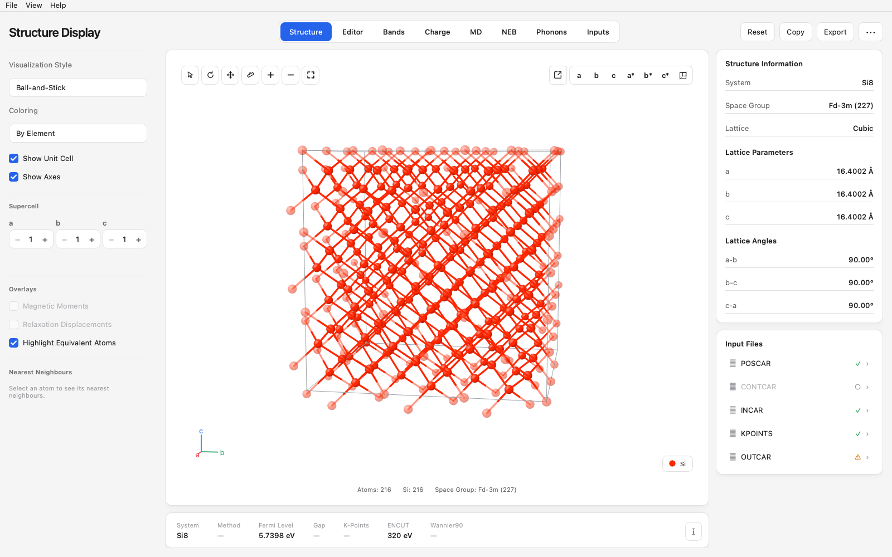
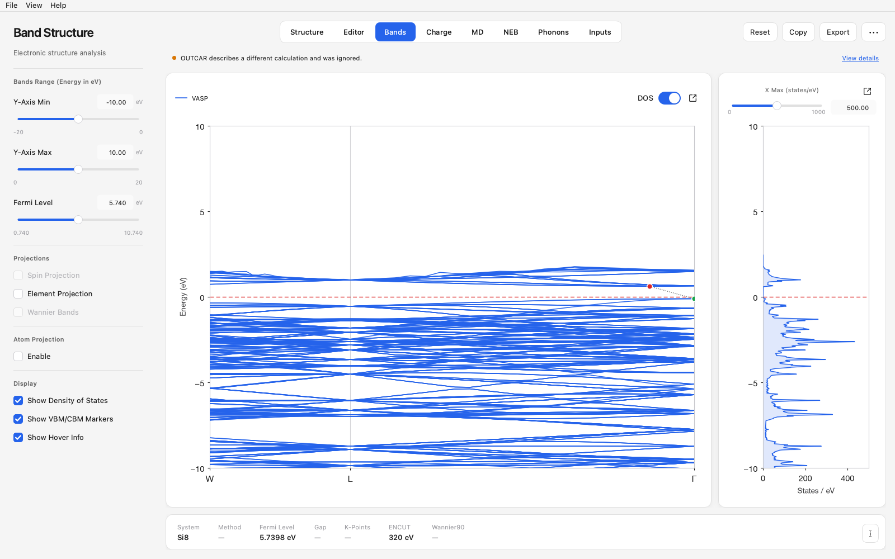
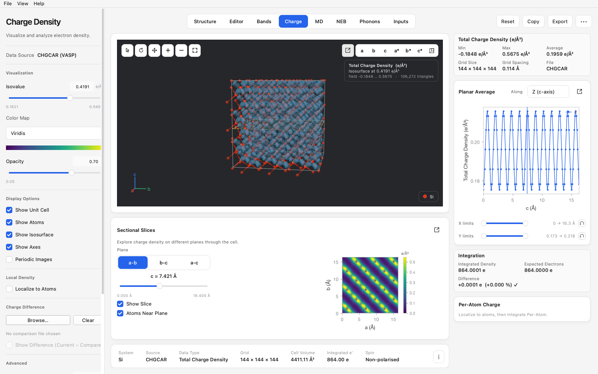
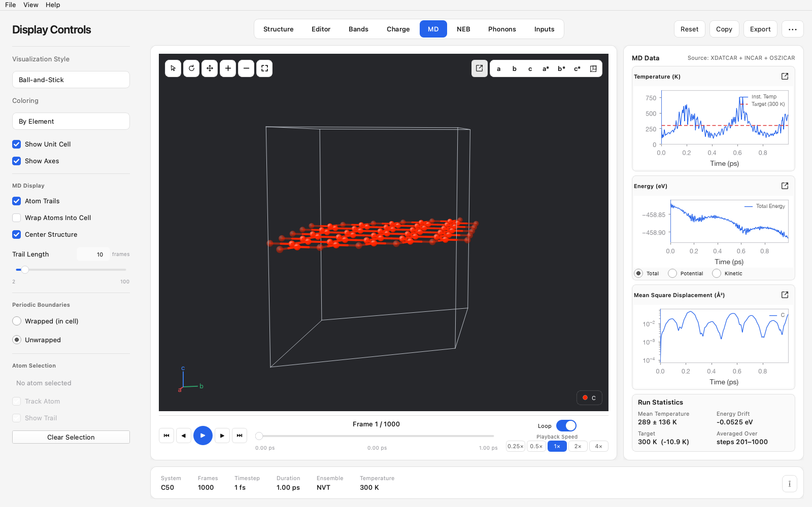
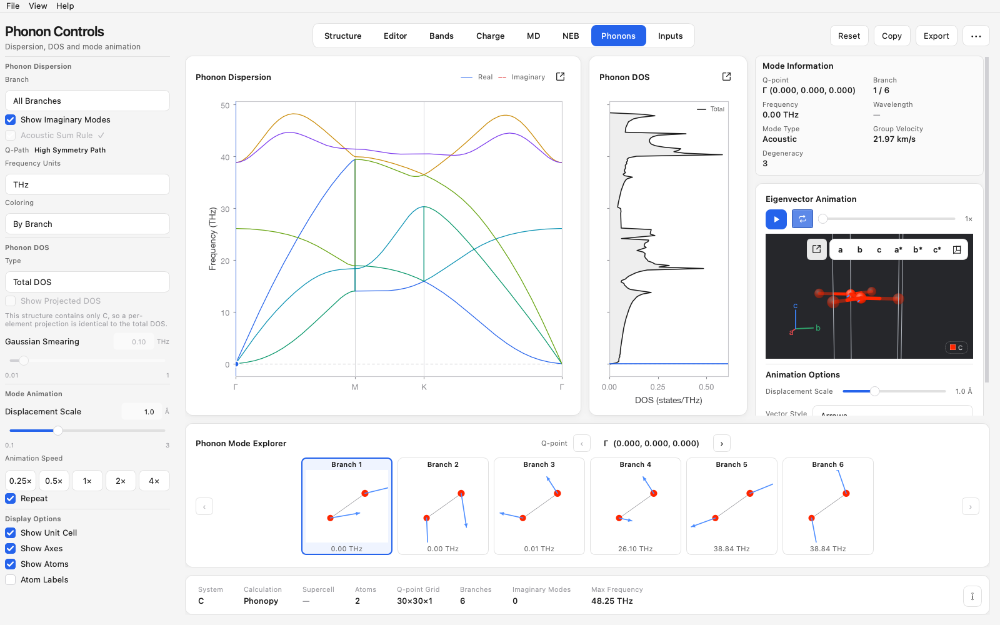

# VASP Analyzer

A desktop application for inspecting and visualising [VASP](https://www.vasp.at/),
[Wannier90](https://wannier.org/) and [phonopy](https://phonopy.github.io/phonopy/)
calculations. Point it at a calculation directory and it works out what is
there, then shows you only what the data actually supports.



## What it does

| Page | What it is for |
|---|---|
| **Structure** | Interactive 3D viewer with bonds, symmetry (space group, Wyckoff sites), supercells, distance/angle measurement, magnetic-moment and relaxation-displacement overlays |
| **Editor** | Build and modify structures — move, add, delete, duplicate, fix atoms — then export as POSCAR, CIF or XYZ |
| **Bands** | Band structure and density of states on a shared energy axis, band gap, element/orbital/atom/spin projection, publication-quality export |
| **Charge** | Real-space CHGCAR/PARCHG/ELFCAR isosurfaces, planar averages, sectional slices, per-atom integration |
| **MD** | Trajectory playback from XDATCAR with atom trails, temperature and energy plots, bond length and angle versus time |
| **NEB** | Reaction-path energy profile, per-image forces and convergence, image-by-image structure playback |
| **Phonons** | Dispersion and phonon DOS, imaginary-mode detection, animated eigenvector display, thermal properties |
| **Inputs** | Browse, search and edit the calculation's input files with validation |

<table>
<tr>
<td width="50%"></td>
<td width="50%"></td>
</tr>
<tr>
<td></td>
<td></td>
</tr>
</table>

## Installing

You need Python 3.11 or newer. On macOS, use a native arm64 Python (Homebrew's,
for example) rather than Anaconda's x86_64 build, which would run the whole GUI
under Rosetta.

```bash
git clone https://github.com/b-mo1998/vasp-analyzer.git
cd vasp-analyzer
python3 -m venv .venv
.venv/bin/pip install -e ".[dev]"
```

Then run it:

```bash
.venv/bin/python -m vasp_analyzer
```

Open a calculation with **⌘O** (**Ctrl+O** on Windows and Linux), or drag a
folder onto the window. The last directory reopens automatically.

### Building a standalone macOS app

See [packaging/BUILDING.md](packaging/BUILDING.md). The result is a normal
`.app` that needs no Python installation on the target machine.

## Documentation

[**user_guide.pdf**](user_guide.pdf) is an illustrated walkthrough of every
page. [install_guide.pdf](install_guide.pdf) covers installing the prebuilt
macOS app for people who do not want to build from source.

## Design

### Capability-based discovery

Opening a directory runs a cheap scan — `stat` plus a few header reads — that
produces a `FileIndex` and a `CapabilitySet`. **The interface binds to
capabilities, never to filenames.** Every unavailable capability carries a
reason, shown as a tooltip or inline note rather than a dialog:

```
DOS unavailable — DOSCAR was not found in this calculation.
```

Heavy data (EIGENVAL, DOSCAR, CHGCAR) is read on a worker thread when a page
first needs it, and cached against `(path, mtime, size)`.

### Scientific integrity

A quantity that cannot be determined shows `—`. Nothing is guessed.

- **Fermi level** — EIGENVAL does not store one. Taken from DOSCAR, then
  OUTCAR, and each only when consistent with the rest of the directory.
- **k-path labels** — only from line-mode KPOINTS. A Monkhorst-Pack or
  Γ-centred mesh has no path, so the axis shows the k-point index and the
  eigenvalues are drawn as points: joining them with lines would assert an
  adjacency in reciprocal space that does not exist.
- **Functional** — reported only when the INCAR states it. A run with no
  exchange-correlation tag is not labelled "PBE".
- **Measurement** — offered on Structure and Editor only. On a trajectory or a
  reaction path the geometry changes frame to frame, so a distance would only
  be true of whichever frame happened to be on screen.

### Cross-file consistency

Calculation folders accumulate stale files. Before using a file's metadata, the
app checks it against the others — band and k-point counts, electron count,
atom count, elements. A file describing a different calculation is marked
inconsistent and ignored, and the mismatch is reported rather than silently
absorbed.

### Errors

Parsers return a `ParseResult` and never raise into the GUI. A truncated file
yields the part that was readable, plus a warning. Short messages go to the
window; full tracebacks go to `~/Library/Logs/VASPAnalyzer/app.log`.

### Layering

Four layers, dependencies pointing one way only (`ui → services → parsers → models`):

```
core/       errors, logging, shared primitives          (no Qt)
models/     typed scientific data + capabilities        (no Qt)
parsers/    one module per file format                  (no Qt)
services/   discovery, validation, loading, symmetry    (Qt signals)
ui/         theme, shell, reusable widgets, pages
```

No parsing logic lives in a widget, and no widget imports a file format.

## Development

```bash
QT_QPA_PLATFORM=offscreen .venv/bin/python -m pytest tests/ -q
```

686 tests covering the parsers, the services and the window itself, including
every partial-calculation scenario: complete, bands-only, no EIGENVAL,
structure-only, partial Wannier, malformed DOSCAR, empty folder. The suite
generates all the data it needs, so no calculation files are required to run
it.

Built with [PySide6](https://doc.qt.io/qtforpython-6/) (Qt for Python),
[matplotlib](https://matplotlib.org/), [NumPy](https://numpy.org/),
[pymatgen](https://pymatgen.org/) and [spglib](https://spglib.readthedocs.io/).

## Contributing

Issues and pull requests are welcome. If you are reporting a parsing problem,
the most useful thing you can attach is the *header* of the file that failed —
the first 20 lines are usually enough, and they contain no results.

## License

[MIT](LICENSE). Note that PySide6 itself is LGPL: that is fine for normal use
and for source distribution, but if you redistribute a bundled binary, check
the Qt licensing terms for your situation.
